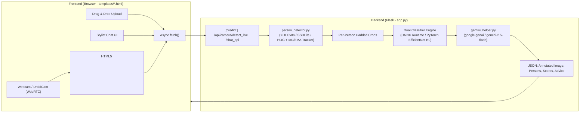

# StyleSense AI — Multi-Person Dress Classifier & Virtual Fashion Stylist

**StyleSense AI** is a full-stack computer vision and generative AI fashion platform that combines real-time **multi-person detection & tracking**, a custom-trained **EfficientNet-B0 outfit classifier** (**Formal**, **Casual**, **Traditional**), and **Google Gemini (`gemini-2.5-flash`)** styling intelligence across an interactive Flask web application and a standalone OpenCV desktop visualizer.

---

## Table of Contents

- [Key Capabilities](#-key-capabilities)
- [System Architecture](#-system-architecture)
- [Tech Stack](#-tech-stack)
- [Project Structure](#-project-structure)
- [AI Models & Training Pipeline](#-ai-models--training-pipeline)
- [Dataset Layout](#-dataset-layout)
- [Installation & Setup](#-installation--setup)
- [Running the Application](#-running-the-application)
- [API Endpoints Reference](#-api-endpoints-reference)
- [Desktop Live Camera CLI (`live_camera.py`)](#-desktop-live-camera-cli-live_camerapy)
- [Automated Test Suites](#-automated-test-suites)
- [Deployment & Environment Notes](#-deployment--environment-notes)
- [Troubleshooting](#-troubleshooting)

---

## ✨ Key Capabilities

### 1. Multi-Person Outfit Detection & Tracking
- **Full-Body Person Localization (`person_detector.py`)**: Detects multiple individuals simultaneously in camera frames and uploaded photos using **YOLOv8 Nano** (`yolov8n.pt`), with automatic fallbacks to **Torchvision SSDLite320 MobileNetV3-Large** and **OpenCV HOG**.
- **Individual Crop & Independent Classification**: Expands each detected bounding box with `4%` adaptive padding, crops every individual separately, applies Non-Maximum Suppression (`apply_nms`), and classifies each person left-to-right into:
  - **Formal** — Blue (`#2b7fff`) `👔`
  - **Casual** — Green (`#2ecc71`) `👕`
  - **Traditional** — Orange (`#ff8c00`) `🥻`
  - **Uncertain / Low Confidence (`< 45.0%`)** — Flagged with a `[Low Match]` badge rather than presenting uncertain results as definitive.
  - **Zero-Person Fallback**: When no distinct person box is detected, gracefully evaluates the full frame as `Person 1`.
- **Real-Time Multi-Person Tracker (`PersonTracker`)**: Assigns consistent IDs (`Person 1`, `Person 2`, …) via IoU matching, smooths coordinates using an **Exponential Moving Average** (`ema_alpha = 0.70`) to eliminate box jitter/flickering, removes departed subjects after `max_disappeared = 10` frames, and caches per-ID attire classifications (`1.0 s` TTL) for smooth live framerates.

### 2. Real-Time Web Camera with Two Independent Toggles
- Accessible from **📱 Real-Time Camera Analysis** on `/` (`templates/home.html`):
  - **Person Detection Toggle** (default: **OFF**): Streams live bounding boxes over the video feed on an HTML5 `<canvas>` overlay (`#liveOverlayCanvas`) with persistent person IDs.
  - **Attire Matching Level Toggle** (default: **OFF**): Independently toggles attire category prediction and confidence percentages.
  - **Toggle Matrix**:
    - `OFF / OFF` → Clean live camera feed.
    - `ON / OFF` → Neutral gold (`#c9a96e`) bounding boxes with `Person {id}` labels only.
    - `ON / ON` → Category-colored bounding boxes (`Blue` / `Green` / `Orange`) with `Person {id}: {Category} ({Confidence}%)`.
    - Turning **Attire Matching ON** automatically enables **Person Detection**; turning **Person Detection OFF** disables **Attire Matching**; turning **Attire Matching OFF** preserves **Person Detection**.
- **WebRTC Camera Switching & Diagnostics**: Enumerates connected webcams and virtual mobile cameras (auto-prioritizing **DroidCam**), provides a live hardware diagnostics HUD (`requested` vs `active` track matching), supports **🤖 Auto Person Scan** (in-browser TensorFlow.js `COCO-SSD` auto-capture when a person is detected with score `> 0.45`), and **📸 Capture & Classify** to render annotated bounding boxes, comparison tables, per-person score cards, and Gemini stylist feedback.

### 3. Category Verification Upload Page (`/upload/<category>`)
- Drag-and-drop or file browser upload supporting `.jpg`, `.jpeg`, `.png`, and `.webp` (`templates/upload.html`).
- Verifies outfits against a target dress code (`Formal`, `Casual`, `Traditional`), displaying an **ACCEPTED / REJECTED** verdict badge alongside multi-person annotated imagery, a summary table, per-person probability bars, and Gemini styling feedback.

### 4. Intent-Aware AI Fashion Stylist Chatbot (`/chatbot`)
- Powered by **Google Gemini (`gemini-2.5-flash`)** via the official `google-genai` SDK (`gemini_helper.py`, `templates/chatbot.html`).
- Retains the last 8 conversation turns for multi-turn context and routes responses based on user intent:
  - **Greetings & Casual Chat** (`"Hi"`, `"How are you?"`) → Natural conversational text reply (including graceful offline/rate-limit greeting responses).
  - **General Fashion Questions** → Direct, concise advice without unnecessary cards.
  - **Follow-Up Questions** → Answers specific follow-ups referencing prior looks without regenerating three new options.
  - **Outfit Recommendation Requests** → Generates **3 structured outfit cards** covering **Outfit**, **Footwear**, **Grooming**, and **Accessories**.

### 5. Dual Inference Engine
- Prefers **ONNX Runtime** (`dress_classifier.onnx` + `preprocess_image_numpy`) for fast, lightweight CPU execution, with seamless fallback to **PyTorch** (`dress_classifier.pth` + `Transforms.inference_transform`) when ONNX is unavailable.

---

## 🏗 System Architecture



---

## 🛠 Tech Stack

| Layer | Technologies Used |
|---|---|
| **Backend Web Framework** | Python (`3.10+`, tested on `3.12.6`), Flask |
| **Clothing Classification** | PyTorch, Torchvision (`EfficientNet-B0`), ONNX Runtime, NumPy, Pillow |
| **Person Detection & Tracking** | Ultralytics `YOLOv8n`, `lap>=0.5.12`, OpenCV (`cv2`), custom IoU + EMA tracker |
| **Generative AI** | `google-genai` SDK (`genai.Client`), `gemini-2.5-flash` |
| **Frontend UI** | HTML5, Jinja2 Templates, Vanilla ES6+ JavaScript, Custom Dark-Mode CSS (CSS variables, glassmorphism, 3D tilt cards), Google Fonts (`Cormorant Garamond`, `DM Mono`) |
| **Browser Vision** | WebRTC `navigator.mediaDevices`, HTML5 `<canvas>`, TensorFlow.js (`@tensorflow/tfjs` + `@tensorflow-models/coco-ssd`) |
| **Hardware Capture / CLI** | OpenCV DirectShow (`CAP_DSHOW`), MJPEG / RTSP streaming, `CameraManager` multi-threaded frame buffer |
| **Dataset Collection** | `icrawler` (`BingImageCrawler`), `selenium` + `webdriver-manager` (optional archive scrapers) |

---

## 📂 Project Structure

```text
Tmodel/
├── app.py                         # Main Flask application, web routes, inference & camera APIs
├── gemini_helper.py               # Centralized google-genai client, key loader & intent-aware chatbot logic
├── person_detector.py             # Multi-person detector (YOLOv8n/SSDLite/HOG), PersonTracker (IoU+EMA) & annotator
├── camera_manager.py              # Thread-safe CameraManager (DirectShow, local HTTP/RTSP streams, mock source)
├── live_camera.py                 # Standalone OpenCV desktop HUD classifier & CLI
│
├── main.py                        # CLI entry point for training, validation eval & single-image prediction
├── initialisation.py              # EfficientNet-B0 builder, device config & CLASS_NAMES
├── Transforms.py                  # PyTorch train/val/inference torchvision transforms
├── dataset.py                     # Custom DressDataset PyTorch Dataset loader
├── two_stage_training.py          # Two-stage transfer learning pipeline (head warmup + full fine-tuning)
├── SaveAndReload.py               # PyTorch checkpoint save/load utilities
├── SingleImageInference.py        # Single-image CLI inference & validation confusion-matrix evaluator
├── download_images.py             # Optional Bing Image Crawler dataset fetcher (icrawler)
│
├── templates/
│   ├── home.html                  # Landing page + WebRTC Live Camera Modal + Two-Toggle tracking UI
│   ├── upload.html                # Category verification upload page with multi-person table & cards
│   ├── chatbot.html               # AI Fashion Stylist interactive chat interface
│   └── index.html                 # Legacy single-image upload interface (standalone template)
│
├── dress_classifier.onnx          # Exported ONNX outfit classification model
├── dress_classifier.pth           # PyTorch trained checkpoint (git-ignored)
├── yolov8n.pt                     # YOLOv8 Nano weights for person detection (git-ignored)
│
├── dataset/                       # Training & validation image splits (git-ignored)
│   ├── train/                     # Formal (402), Casual (441), Traditional (473)
│   └── val/                       # Formal (97), Casual (108), Traditional (129)
│
├── a/                             # Auxiliary Pinterest Selenium scraper archive & raw scraped images
│   ├── main.py / main1.py         # Selenium Chrome Pinterest scraper
│   └── dataset/                   # Unsplit scraped folders (casual, formal, tredtional)
│
├── test_camera_pipeline.py        # Unit/integration tests for camera manager, detector, Gemini & Flask routes
├── test_live_camera_toggles.py    # Tests for independent toggles, tracker ID stability, EMA & caching
├── test_chatbot_intent_suite.py   # Tests for conditional chatbot intent routing
│
├── requirements.txt               # Active runtime Python dependencies
├── requirements-dev.txt           # Legacy local training/crawler dependency list
├── vercel.json                    # Vercel Python serverless deployment config
├── USB_MOBILE_CAMERA_SETUP.md     # Detailed DroidCam / Iriun / IP Webcam / Android 14+ camera setup guide
├── backend_detailed_doc.txt       # Legacy API contract notes
└── api_key.txt                    # Local Gemini API key file (git-ignored; create locally)
```

---

## 🧠 AI Models & Training Pipeline

### Clothing Classifier (`EfficientNet-B0`)
- **Architecture (`initialisation.py`)**: `torchvision.models.efficientnet_b0` initialized with `IMAGENET1K_V1` weights, replacing `classifier[1]` (`1280 → 3` outputs for `['Formal', 'Casual', 'Traditional']`).
- **Two-Stage Training (`two_stage_training.py`)**:
  - **Stage 1 (`5` epochs)**: Backbone frozen (`freeze_backbone=True`); trains only the linear classification head with `Adam` (`lr=1e-3`).
  - **Stage 2 (up to `25` epochs)**: Unfreezes all layers; fine-tunes end-to-end with `Adam` (`lr=5e-5`), `CosineAnnealingLR` (`T_max=25`), `CrossEntropyLoss(label_smoothing=0.1)`, `WeightedRandomSampler` for class balancing, and early stopping (`PATIENCE=7`).
- **Augmentations (`Transforms.py`)**: Resize (`256×256`), `RandomCrop(224)`, horizontal flip (`p=0.5`), `ColorJitter`, `RandomRotation(20°)`, random grayscale, perspective distortion, ImageNet normalization, and `RandomErasing`. Validation/inference resizes to `224×224` with ImageNet normalization.

### Running Model Training, Evaluation & CLI Prediction (`main.py`)
```bash
# Train from scratch using dataset/ and save best checkpoint to dress_classifier.pth
python main.py train

# Evaluate validation split and print per-class accuracy + confusion matrix
python main.py eval

# Classify a single image via PyTorch checkpoint
python main.py predict path/to/image.jpg

# Or run SingleImageInference.py directly (with an image path, or no args to evaluate val split)
python SingleImageInference.py path/to/image.jpg
python SingleImageInference.py
```

---

## 📁 Dataset Layout

The training and evaluation scripts expect images (`.jpg`, `.jpeg`, `.png`, `.webp`) organized under `dataset/` as:

```text
dataset/
├── train/
│   ├── Casual/       # 441 images
│   ├── Formal/       # 402 images
│   └── Traditional/  # 473 images
└── val/
    ├── Casual/       # 108 images
    ├── Formal/       # 97 images
    └── Traditional/  # 129 images
```

*(Current local dataset total: **1,316** training images + **334** validation images = **1,650** images. `dataset/` is ignored in `.gitignore`.)*

Optional data acquisition helpers included in the repository:
- `download_images.py`: Downloads images per query using `BingImageCrawler` (`icrawler`). Note: queries include `Sportswear`, though `DressDataset` (`dataset.py`) and `initialisation.py` load the 3 active classes (`Formal`, `Casual`, `Traditional`).
- `a/main.py`: Selenium + ChromeDriver Pinterest scraper (requires `selenium`, `webdriver-manager`, and `requests`, which are not listed in `requirements.txt`).

---

## 🚀 Installation & Setup

### Prerequisites
- **Python 3.10+** (verified on Python `3.12.6`)
- `pip`
- *(Optional)* NVIDIA GPU with CUDA for accelerated PyTorch training/inference
- *(Optional)* **DroidCam**, **Iriun Webcam**, or **IP Webcam** for streaming a smartphone camera (see [USB_MOBILE_CAMERA_SETUP.md](USB_MOBILE_CAMERA_SETUP.md))

### 1. Create and Activate a Virtual Environment
```bash
# Windows (PowerShell)
python -m venv venv
.\venv\Scripts\activate

# macOS / Linux
python3 -m venv venv
source venv/bin/activate
```

### 2. Install Dependencies
```bash
pip install -r requirements.txt
```
This installs `flask`, `pillow`, `google-genai`, `numpy`, `onnxruntime`, `opencv-python`, `torch`, `torchvision`, `ultralytics`, and `lap>=0.5.12`.

### 3. Configure the Gemini API Key
`gemini_helper.py` resolves your API key in the following priority order (stripping accidental whitespace or surrounding quotes):
1. `api_key.txt` in the project root containing **only** the raw API key string *(already excluded from Git in `.gitignore`)*.
2. `GEMINI_API_KEY` environment variable.
3. `GOOGLE_API_KEY` environment variable.

Example (PowerShell):
```powershell
$env:GEMINI_API_KEY="your_actual_gemini_api_key_here"
```

### 4. Verify Model Files
Ensure `dress_classifier.onnx` (and/or `dress_classifier.pth`) and `yolov8n.pt` are present in the project root.

---

## 💻 Running the Application

Start the Flask server:
```bash
python app.py
```
Then open your browser at:
```text
http://127.0.0.1:5000
```

| Web Route | Page |
|---|---|
| `/` | Home dashboard & Live Camera Modal (`home.html`) |
| `/upload/Formal`, `/upload/Casual`, `/upload/Traditional` | Category-targeted upload & multi-person evaluator (`upload.html`) |
| `/chatbot` | AI Fashion Stylist chat interface (`chatbot.html`) |
| `/health` | JSON system health, device, active camera & API key status |

---

## 🔌 API Endpoints Reference

| Endpoint | Method | Description |
|---|---|---|
| `/` | `GET` | Serves main UI (`templates/home.html`). |
| `/upload/<category>` | `GET` | Serves upload evaluator UI (`templates/upload.html`). |
| `/chatbot` | `GET` | Serves AI stylist chat UI (`templates/chatbot.html`). |
| `/health` | `GET` | Returns `{status, device, camera, has_gemini_key}`. |
| `/predict` | `POST` | Accepts `multipart/form-data` (`image`). Runs multi-person detection, per-person attire classification, bounding box annotation, and Gemini styling advice. Returns JSON with `total_persons`, `persons`, `annotated_image` (Base64 JPEG), `ai_feedback`, and top-person fields (`predicted_class`, `confidence`, `scores`, etc.). |
| `/chat_api` | `POST` | Accepts JSON `{message, history?}`. Routes via `gemini-2.5-flash` to return `{type: "suggestions", data: [3 outfits], reply}` or conversational `{type: "text", reply}`. |
| `/api/camera/devices` | `GET` | Scans DirectShow indices (`0–3`), open local DroidCam/IP Webcam ports (`4747`, `8080`), and `mock` test source. |
| `/api/camera/status` | `GET` | Returns current `CameraManager` status (`status`, `source`, `is_running`, `current_fps`, `frame_count`, `resolution`, `reconnect_attempts`). |
| `/api/camera/select` | `POST` | Switches camera source (`{source}`). **Localhost-only** (`127.0.0.1`, `localhost`, `::1`); validates index (`0–10`), `'mock'`, or `http`/`https`/`rtsp` URLs. |
| `/video_feed` | `GET` | Streams `multipart/x-mixed-replace` MJPEG video from `CameraManager`. |
| `/api/camera/capture_and_predict` | `POST` | Grabs the latest frame from `CameraManager` and runs the full multi-person pipeline + Gemini advice. |
| `/api/camera/detect_live` | `POST` | Low-latency real-time tracking endpoint. Accepts JSON `{image? (base64), classify_attire?: bool}` or multipart `image` (or reads from `CameraManager`), updating the stateful `PersonTracker`. |

---

## 📷 Desktop Live Camera CLI (`live_camera.py`)

For standalone OpenCV desktop inference with a live side HUD and FPS counter:

```bash
# Auto-detect best camera (USB/stream prioritized over integrated webcam, defaults to toggles OFF)
python live_camera.py

# Specify camera index, local IP Webcam/DroidCam stream, or synthetic mock stream
python live_camera.py --source 1
python live_camera.py --source http://127.0.0.1:8080/video
python live_camera.py --source mock

# Start with Person Detection & Attire Matching enabled immediately
python live_camera.py --source 0 --detect-person --match-attire

# Headless verification test (runs N frames and exits without GUI window)
python live_camera.py --source mock --headless-frames 5 --detect-person --match-attire
```

### CLI Arguments
- `--source`: Camera index (`'0'`, `'1'`), stream URL, or `'mock'`
- `--width` / `--height`: Capture resolution (default `1280×720`)
- `--fps`: Target FPS (default `30`)
- `--interval`: Run AI inference every `N` frames (default `3`)
- `--detect-person`: Enable Person Detection on startup (default `False`)
- `--match-attire`: Enable Attire Matching on startup; automatically enables detection (default `False`)
- `--headless-frames`: Exit cleanly after processing `N` frames without opening an OpenCV window

### Keyboard Controls
- `[D]` — Toggle Person Detection bounding boxes (`ON`/`OFF`)
- `[A]` — Toggle Attire Matching categories & confidence (`ON`/`OFF`; auto-enables Detection)
- `[S]` — Query Gemini AI Stylist for current detected person(s)
- `[C]` — Cycle to next detected camera source
- `[SPACE]` — Freeze / Unfreeze display frame
- `[Q]` or `[ESC]` — Quit application

See [USB_MOBILE_CAMERA_SETUP.md](USB_MOBILE_CAMERA_SETUP.md) for detailed instructions on DroidCam (Wi-Fi/USB), Iriun Webcam, IP Webcam + ADB port forwarding, and Android 14+ native USB webcam mode.

---

## ✅ Automated Test Suites

Run unit and integration tests using Python's built-in `unittest` runner:

```bash
# 1. Real-time independent toggles, IoU tracking, EMA smoothing, caching & /api/camera/detect_live (9 tests)
python -m unittest test_live_camera_toggles.py

# 2. Chatbot conditional intent rules (greetings, Q&A, 3-option outfit cards, follow-ups) (7 tests)
python -m unittest test_chatbot_intent_suite.py

# 3. CameraManager, multi-person fallback/dataset inference, color mapping & Flask endpoints (19 tests)
python -m unittest test_camera_pipeline.py
```

---

## ☁ Deployment & Environment Notes

- **Git Tracking (`.gitignore` & `.gitattributes`)**:
  - `api_key.txt`, `.env`, `dataset/`, `venv/`, PyTorch checkpoints (`*.pth`), and YOLO weights (`*.pt`) are ignored by Git to avoid secret leaks and large binary blobs.
  - `dress_classifier.onnx` is tracked so ONNX-only deployments can run directly without PyTorch checkpoints.
- **Vercel Serverless Config (`vercel.json`)**:
  - `vercel.json` builds `app.py` with `@vercel/python` and routes `/(.*)` to the Flask app.
  - **Important**: The current `requirements.txt` includes full local computer vision & camera dependencies (`torch`, `torchvision`, `ultralytics`, `opencv-python`, `lap>=0.5.12`) and `camera_manager.py` / `person_detector.py` import `cv2` directly. Because those packages exceed Vercel Serverless Function size limits, deploying to Vercel requires trimming `requirements.txt` to ONNX-only runtime packages (`flask`, `pillow`, `google-genai`, `numpy`, `onnxruntime`), guarding or removing `cv2`-dependent modules, and setting `GEMINI_API_KEY` in the Vercel project environment variables.

---

## 🛠 Troubleshooting

- **Chatbot shows invalid API key or quota errors**: Verify `api_key.txt` contains only the raw key (no quotes or placeholders) or set `GEMINI_API_KEY`. Note that Google AI Studio free-tier keys for `gemini-2.5-flash` are subject to daily request limits (`HTTP 429 RESOURCE_EXHAUSTED`); outfit classification continues to work independently even if Gemini is unavailable.
- **WebRTC camera shows the wrong device or fails to stream**: Use the built-in **Hardware & Stream Diagnostics HUD** inside the Live Camera modal to verify `Requested DeviceID` vs `Active Track DeviceID`, close other apps locking the webcam (Zoom, Teams, Skype), or click **🔄 Rescan**.
- **YOLOv8 weights (`yolov8n.pt`) missing**: Ensure `yolov8n.pt` is in the project root (Ultralytics will otherwise attempt to download it on first run, or `person_detector.py` will fall back to Torchvision SSDLite / OpenCV HOG).
- **Test offline without a physical camera**: Run `python live_camera.py --source mock` or test `/api/camera/select` with `{"source": "mock"}`.
